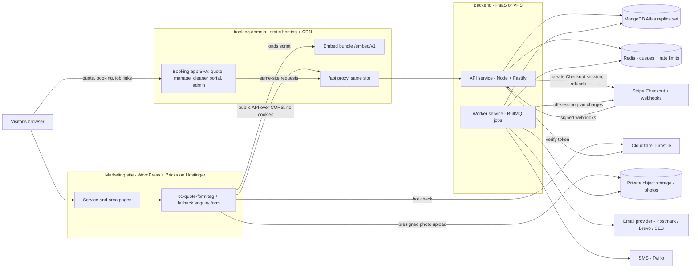
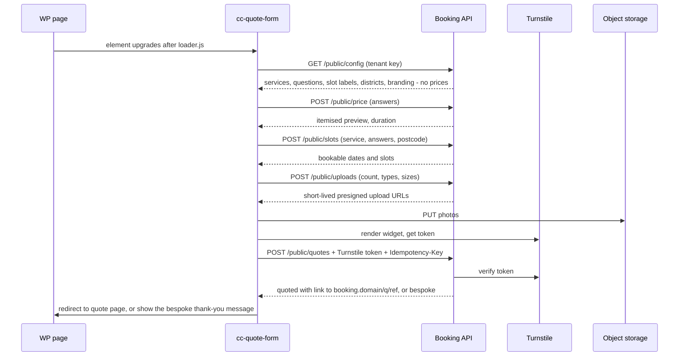
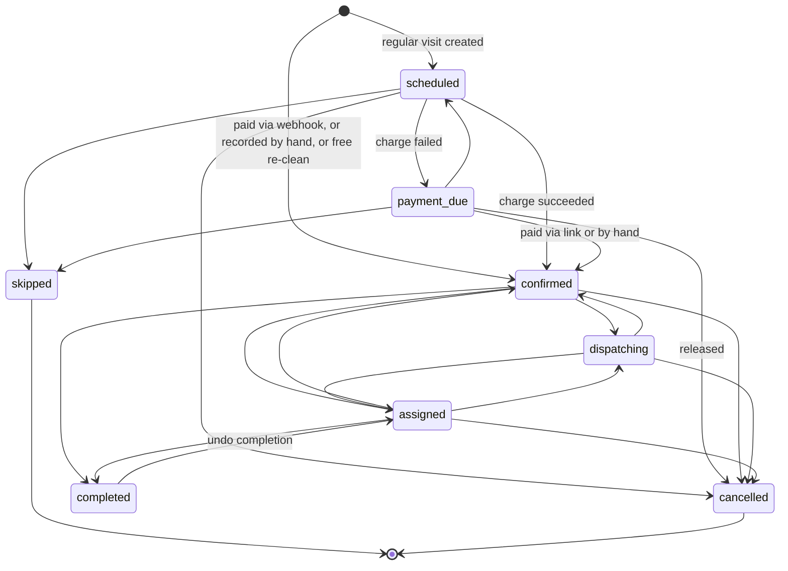
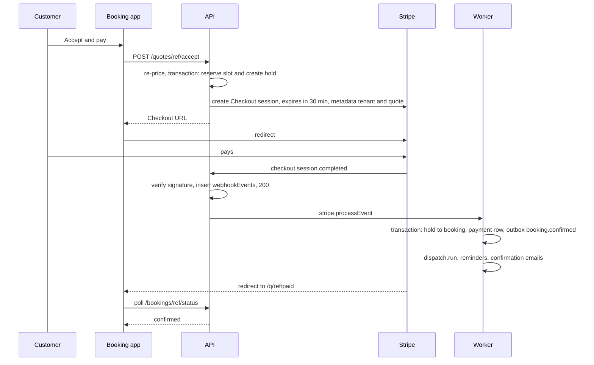
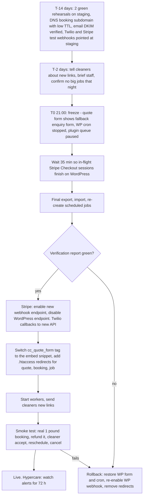
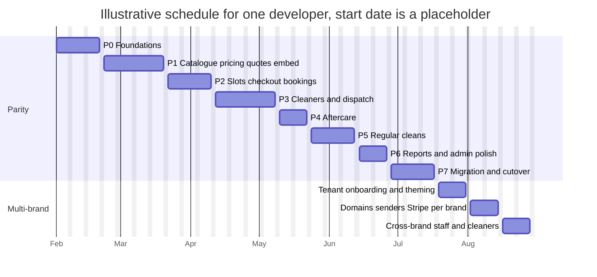

# Standalone Booking Platform — Architecture Plan

**Status:** Draft for review · **Date:** October 2026 · **Build window:** after launch (not before)
**Builds on:** `quote-to-booking-automation.md` (§1–13 product spec, §14 implementation notes) and the live `cc-bookings` plugin (Phases 1–3 live, Phase 4 regular cleans in progress).
**Scope:** architecture and plan only. No application code is written as part of this document.

---

## 1. Summary (for the owner)

### What this is
Today the whole booking system (quote form, quote pages, payment, cleaner job pages, admin) runs inside the WordPress site as the `cc-bookings` plugin. This plan moves it into its **own app**:

- The **marketing website stays exactly where it is** (WordPress + Bricks on Hostinger). The only booking piece on it is the **quote form**, which is dropped in with one line of code.
- Everything else moves to **`booking.<your-domain>`**: quote pages, payment, "manage my booking", re-clean claims, the cleaner portal and the admin dashboard.
- The "engine" behind it (prices, slots, payments, dispatch, reminders) runs on a **separate server and database**, away from the shared WordPress hosting.

### Recommendation
1. **Launch on the plugin.** It works, it is tested on the server, and Phases 1–3 cover the full flow. Rebuilding first would delay revenue by around six months for no customer benefit.
2. **Run it live for at least 2–3 months.** Real bookings show which prices, rules and screens actually matter. That makes the rebuild smaller and safer.
3. **Build the standalone app when one of the triggers below happens.** Plan around six months for one developer to reach "everything the plugin does", then a few more weeks for multi-brand extras.

### When to switch (triggers)
Start the build when **any one** of these happens:

| Trigger | Why it matters |
|---|---|
| A **second brand** (e.g. goldencleaners.co.uk) is ready to take bookings | The plugin is tied to one WordPress site. A second copy would mean two admins, two cleaner lists and two sets of prices to keep in step. |
| Cleaners need a **proper app** (push notifications, setting their own availability, pay history) | Signed links work, but an app needs a real API and logins. |
| **Hosting limits** show up: missed or late reminders or card charges, a slow admin, PHP limits, caching mistakes, or any security scare on the WordPress site | Shared hosting runs the website, the plugins and the bookings together. A problem in one affects the others. Customer data and Stripe keys sit next to every WordPress plugin. |
| **Regular plans** become a big share of revenue | Automatic card charges have to run on time, every time. A proper job queue is far more reliable than WordPress cron. |
| **Volume**: roughly 300+ bookings a month, or more than one person working in the admin | It becomes worth having staff roles, a faster admin and integrations (accounting, payroll). |

A redesign on its own is **not** a reason to switch. The plugin's screens can be improved in place.

### What it costs (rough)
- **Build:** about **19–24 developer-weeks** to match the plugin (plan for ~6 months with contingency), plus **4–7 weeks** for multi-brand extras. See §10.
- **Running costs:** about **£35–£60 a month** on a lean setup, **£90–£140 a month** for the recommended production setup, plus text-message usage and the same Stripe fees as today. See §8.

### What changes for people
- **Customers:** nothing visible apart from the address of quote and booking pages (`booking.<domain>/…`). Old email links keep working.
- **Cleaners:** the same "tap a link" job pages, plus an optional login to a portal (installable on the phone's home screen) for upcoming jobs, availability and pay.
- **You and staff:** a dedicated admin with staff roles, instead of WordPress admin screens. Prices and services are edited there, not in WordPress.

### Key technical decisions (short decision records)
These are explained in plain terms so you can approve or change them. Detail follows in later sections.

| # | Decision | Default in this plan | Note |
|---|---|---|---|
| DR-1 | **UI library** | **Chakra UI v2** (as requested) | Chakra **v3** (released late 2024) is the current version. **v2 is in maintenance mode** (fixes only, no new features). Starting a multi-year build on v2 means a forced upgrade later. If you stay on v2, all Chakra components are wrapped in our own `packages/ui`, so the later upgrade touches one package. **My recommendation: start on v3** unless the developer has strong v2 templates. |
| DR-2 | **Database** | **MongoDB** (as requested) | **My preference for booking and payment data is PostgreSQL.** The data is relational (bookings ↔ offers ↔ payments ↔ plans), and Postgres gives constraints, serialisable transactions and SQL reporting for free. Staying on MongoDB is workable **if it is designed for it** (§6): a replica set (MongoDB Atlas) for multi-document transactions, unique indexes, atomic conditional updates for slot capacity and first-to-accept, and idempotency keys for Stripe webhooks. All database access goes through a repository layer, so switching later is a contained job (around 2–3 weeks), not a rewrite. |
| DR-3 | **Backend** | Node.js 24 LTS + TypeScript + **Fastify** | Fast, typed request validation (zod) and auto-generated API docs (OpenAPI), which a future mobile app can use. |
| DR-4 | **Background jobs** | **BullMQ + Redis** | Replaces WordPress Action Scheduler. The database stays the source of truth; the queue can always be rebuilt from it (§5.4). |
| DR-5 | **Quote form on the website** | A **web component** with Shadow DOM, **without Chakra** | Chakra's styling engine injects CSS into the page's `<head>`, which leaks into or clashes with Bricks and doesn't reach inside Shadow DOM without extra work. The embed uses React with its own small stylesheet so it stays light (target under 80 KB compressed). The full-page quote route on the booking app reuses the same component. |
| DR-6 | **Payments** | Keep **Stripe Checkout** (Stripe-hosted page) | Keeps PCI scope at the lightest level (SAQ A). Card numbers never touch our servers. |
| DR-7 | **Logins** | Passwordless (magic links) for staff and cleaners, private signed links for customers | No passwords to leak or reset. Customers never need an account. |

---

## 2. System overview



**Principles**
- **WordPress becomes a pure marketing site.** It stores no customer data, no prices and no API keys.
- **One engine, many brands.** Every record carries a `tenantId`. A brand (tenant) has its own domains, branding, prices, cleaners, Stripe account, email sender and templates.
- **The database is the source of truth.** Queues, caches and rate limits live in Redis and can be rebuilt.
- **The server always re-prices.** As today, the browser's total is never trusted (spec §11).
- **Confirmation only comes from Stripe's webhook**, never from the browser redirect (spec §6).

---

## 3. Quote form embed

### 3.1 How it goes on a page

```html
<script src="https://booking.<domain>/embed/v1/loader.js" async></script>
<cc-quote-form tenant="pk_live_tenant_xxx" service="end-of-tenancy-cleaning">
  <!-- Fallback, shown if the script or API is unavailable -->
  <p>Call us on 01482 000000 or send us your details:</p>
  [the existing Bricks enquiry form]
</cc-quote-form>
```

- The `tenant` attribute is a **publishable** key (safe to show), not a secret.
- `service` is optional and preselects a service. Service pages use it; the "Get a quote" page leaves it out.
- **No page edits are needed at cutover.** The theme's `{cc_quote_form}` dynamic tag is switched to output this snippet. That is a one-line change in a tiny replacement plugin or snippet, made at cutover, not now.
- The loader is small and cached for a few minutes. It loads hashed, immutable chunks, so a new release reaches every site within minutes without anyone editing WordPress.

### 3.2 Shadow DOM and per-brand theming
- The component attaches an **open Shadow DOM**. Its styles are applied with constructable stylesheets (`adoptedStyleSheets`, with a `<style>` fallback). Bricks CSS can't break the form, and the form's CSS can't leak onto the page.
- `:host { all: initial; display: block; }` stops inherited page styles such as line-height and colour from leaking in. Inheritance does cross the shadow boundary.
- **Brand theming** comes from the tenant config: colours, radius, font family and logo, applied as CSS custom properties (`--cc-color-primary`, `--cc-radius`, `--cc-font-family`, …). A site can override any of them on the tag, and deeper tweaks use `::part()` (e.g. `cc-quote-form::part(button-primary)`).
- **Fonts:** `@font-face` rules must live in the page, not the shadow root. By default the form inherits the site's font (`--cc-font-family: inherit`). The loader can inject a brand font into the page `<head>` if a tenant needs one.
- **Accessibility:** focus moves to each step's heading (as in today's `quote-form.js`), and `delegatesFocus` is enabled. Test browser autofill (`autocomplete` attributes) in Safari and Chrome, because autofill inside shadow roots has had quirks.
- **Analytics without cookies in the embed:** the component dispatches DOM events (`cc:step`, `cc:quote-submitted`, `cc:quote-bespoke`) on the host element. The website's own analytics (under its own consent banner) can listen for them. The embed itself sets no cookies and loads no trackers.

### 3.3 Talking to the API



- **CORS:** `/public/*` routes accept only origins listed for the tenant (e.g. `https://deeppink-woodcock-284086.hostingersite.com`, `https://goldencleaners.co.uk`). Requests use `credentials: 'omit'` and the API never sends `Access-Control-Allow-Credentials`. Preflights are cached (`Access-Control-Max-Age`).
- **No third-party cookies anywhere.** The embed is stateless. Tenant identity comes from the publishable key **and** a matching `Origin`. Anything personal lives server-side behind the quote token.
- **Turnstile:** keep the explicit-render approach used today. Render the widget into a **slotted light-DOM element** (`<div slot="turnstile">`), because Turnstile's iframe is not guaranteed to work inside a shadow root. Each tenant's marketing hostnames are added to the Turnstile widget. Keep the existing honeypot, minimum fill time (3 s) and per-IP rate limits.
- **Photos** go straight to private storage through presigned URLs (max 6 files, 8 MB each, the same image types as today). The quote only references uploads the API issued. A worker checks file signatures, strips EXIF/GPS metadata and makes thumbnails.

### 3.4 SEO and the no-prices rule
- **No prices in public HTML.** The WordPress page contains only the tag and the fallback. `/public/config` mirrors today's `Catalog::public_config()`: names, questions and "priced on request" flags, never amounts. Prices only appear in the JSON response to `POST /public/price`, on private quote pages, in emails and in the admin.
- `/public/config` can be edge-cached for 5 minutes (no prices, no personal data). Price, slot and quote responses are always `Cache-Control: no-store`.
- **Every response from the booking host and the API sends `X-Robots-Tag: noindex, nofollow`.** Private pages are rendered client-side only after the token is checked. Don't rely on `robots.txt` alone.
- **Tokens stay out of server logs and Referer headers.** New links put the token in the URL fragment (`/q/Q-24817#k=…`), which browsers never send to servers. The app sends it to the API in a header. Plus `Referrer-Policy: no-referrer`.

### 3.5 If the API is down
| Failure | What the visitor sees |
|---|---|
| `loader.js` can't load (CDN or DNS problem) | The custom element never upgrades, so its **light-DOM children render as normal HTML**: phone number plus the existing Bricks enquiry form, which emails the admin through WordPress. This matches today's behaviour when the plugin is off. |
| Config request fails or takes over 8 s | The component shows the slotted fallback, with the message "Instant quotes are temporarily unavailable — send us your details instead". |
| Submit fails (5xx or network) | Up to 2 automatic retries using the same `Idempotency-Key`, so no duplicate quotes are created. Then the fallback form, pre-filled with what the visitor typed. |

A public `/health` endpoint plus uptime monitoring (§8) alerts you within minutes.

---

## 4. Frontend apps

### 4.1 Route map (`booking.<domain>`)
One Vite + React SPA, with a separate bundle per area (lazy-loaded) so customers never download admin code. No server-side rendering is needed, because nothing on this host should be indexed.

| Route | Who | What | Replaces (plugin) |
|---|---|---|---|
| `/` | — | Redirect to the brand's marketing site | — |
| `/quote` | Public | Full-page quote form (the same web component). Used for "change details", re-quotes and direct links | `{cc_quote_form}` on `/contact/` |
| `/q/:ref` | Customer token | Quote page: itemised price, terms ticks, early-start consent, regular-plan card authority, Accept & pay, ask a question, expiry or re-quote | `/quote/{ref}/{token}/`, `templates/quote.php` |
| `/q/:ref/paid` | Customer token | Return from Stripe. Polls status ("Confirming your payment…") and **never confirms on its own** | Checkout success URL |
| `/q/:ref/cancelled` | Customer token | Return from Stripe without paying. The hold is released or kept until it expires | Checkout cancel URL |
| `/b/:ref` | Customer token | Manage booking: details, status, reschedule, cancel with a refund preview, plan panel (skip, pause, frequency, cancel, update card) | `/booking/{ref}/{token}/`, `class-manage.php`, `class-plan-manage.php` |
| `/b/:ref/reclean` | Customer token | Re-clean claim with photos (inside 72 h, one per booking) | `class-reclean.php` panel |
| `/b/:ref/pay` | Customer token | Pay a "payment due" regular visit, or a top-up | Plan pay link, top-up link |
| `/links` | Public | "Email me my booking links" (same response whether or not the email is known) | New |
| `/j/:offerId` | Cleaner link token | Job page: offer (district only) → accepted (address, access notes, phone from 24 h before), Can't make it, Mark complete with photos | `/job/{offer}/{sig}/`, `templates/job.php` |
| `/cleaner` | Cleaner session | Portal: upcoming jobs, job detail, availability and time off, pay summary. Installable PWA | `/job/me/{cleaner}/{sig}/` (extended) |
| `/login`, `/auth/verify` | Staff, cleaners | Magic-link sign-in (cleaners can also use an SMS code) | WordPress login |
| `/admin` | Staff session | Dashboard: today and tomorrow, unassigned jobs, bespoke quotes waiting, recent payments | `admin/class-dashboard.php` |
| `/admin/quotes[/:id]` | Staff | List, bespoke pricing, send, record payment | `class-quotes-screen.php` |
| `/admin/bookings[/:id]`, `/admin/calendar` | Staff | List and calendar, booking timeline, assign, refund, top-up link, move, complete, after-booking box | `class-bookings-screen.php`, aftercare sidebar |
| `/admin/dispatch` | Staff | Jobs waiting for a cleaner, re-run, re-offer with bonus, SMS log | `class-dispatch-screen.php` |
| `/admin/cleaners[/:id]` | Staff | Profiles, areas, services, weekly hours, time off, pay, links | `class-cleaner-profiles-screen.php`, `class-cleaners-screen.php` |
| `/admin/plans[/:id]` | Staff | Regular plans and visits: charge, skip, mark paid, release, pause, frequency | `class-plans-screen.php` |
| `/admin/aftercare` | Staff | Re-clean claims, pending manual refunds | `class-aftercare-screen.php` |
| `/admin/reports` | Owner, finance | Revenue, conversion, by service, area and month, cleaner pay, CSV exports | `class-reports-screen.php` |
| `/admin/activity` | Staff | Audit log, email and SMS log | `class-activity-screen.php` |
| `/admin/catalogue` | Owner, admin | Services, price tables (with hours and cleaners), add-ons, minimums, areas | SCF fields on `cc_service`, `cc_area` |
| `/admin/settings/*` | Owner, admin | Pricing factors, slots and notice, quotes, dispatch, aftercare, recurring, email and SMS templates, brand, users | `class-settings-screen.php` + per-phase settings |
| `/platform/*` | Platform owner | Tenants, domains, secrets status, feature flags | New |

**Hostnames:** customer and cleaner pages run on each brand's own host (`booking.<brand>`), so links, emails and branding match the brand. The admin starts on the first brand's host. Once there are several brands it can move to a neutral host (e.g. `app.<platform-domain>`) with a tenant switcher (open decision §11).

### 4.2 Authentication and roles
| Who | How they sign in | Session |
|---|---|---|
| **Staff** (owner, admin, dispatcher, finance, viewer) | Magic link by email (single use, expires in 15 min, only the hash is stored). Optional passkey later. **Owner and admin roles must add a second factor** (passkey or TOTP) before Stripe refunds and secrets screens | httpOnly, Secure, `SameSite=Lax` cookie. 12 h idle timeout, 7 days maximum. Sessions are stored server-side (revocable) |
| **Cleaners** | Magic link by email **or** a 6-digit SMS code. Per-job signed links keep working without signing in | Same cookie session, 30 days, revoked when the cleaner is deactivated or "Revoke link" is pressed |
| **Customers** | No accounts. Each quote, booking and plan has a random 32-byte token; only its SHA-256 hash is stored, and the last 10 stay valid (same as `Tokens::KEEP`) | Token sent in a header per request. Scopes: `quote:view/accept`, `booking:manage`, `plan:manage` |

- **Roles are tenant memberships:** a user can be `admin` on one brand and `viewer` on another. Every admin API call checks role and tenant on the server.
- **First-party cookies only.** The app calls the API on the **same site**: either `/api` on the booking host through an edge rewrite (Vercel and Netlify rewrites, or a Cloudflare Pages Function or Worker), or `api.<brand>` as a second custom domain on the API. Both are same-site, so cookies are never third-party, even for a second brand.
- **Build it in-house** (magic links, sessions and roles are a small, well-understood module) or use a hosted provider (Clerk, Stytch, Auth0). In-house is cheaper and keeps cleaner phone numbers in our own database (open decision §11).
- CSRF protection: `SameSite=Lax`, plus an `Origin` check on all state-changing requests.

### 4.3 Monorepo layout (pnpm workspaces + Turborepo)

```text
cc-platform/
  apps/
    embed/          Web component + loader (Vite library build, React, plain CSS, no Chakra)
    web/            Booking SPA: customer, cleaner portal, admin (Vite, React, Chakra, React Router, TanStack Query)
    api/            Fastify HTTP API (REST + webhooks), OpenAPI generated from zod schemas
    worker/         BullMQ workers + schedulers (same codebase as api, separate process)
  packages/
    shared/         zod schemas, TypeScript types, status machines, constants (slots, statuses, roles)
    pricing/        Pure pricing engine (port of Pricing::price + recurring adjustments), fixtures, parity tests
    domain/         Business modules (quotes, bookings, dispatch, plans …) used by api and worker
    db/             Mongo client, tenant-scoped repositories, index definitions, migrations
    integrations/   Stripe, Twilio, email provider, Turnstile, storage adapters (with log-only/simulated modes)
    emails/         Email layout (React Email) + template rendering with {tokens} like today
    ui/             Chakra theme + wrapped components + brand tokens (contains the Chakra v2/v3 dependency)
    api-client/     Typed client generated from OpenAPI (web, embed, future mobile app)
    config/         tsconfig, eslint, prettier presets
  tools/
    migrate-wp/     WordPress export reader + importers + verification report (§9)
    cli/            Ops CLI replacing WP-CLI commands (price, simulate-payment, dispatch status …)
  infra/            docker-compose for local dev, deploy configs, Atlas/Redis setup notes
```

**Frontend libraries:** React (pinned to the version the chosen Chakra release supports), React Router, TanStack Query, react-hook-form + zod, TanStack Table, a calendar component (e.g. FullCalendar standard), `vite-plugin-pwa` for the cleaner portal.

---

## 5. Backend

### 5.1 Modules (feature parity map)
Each module owns its collections and talks to others through function calls or domain events, never by writing another module's data.

| Module | Responsibilities | Replaces in `cc-bookings` |
|---|---|---|
| **tenants** | Brands, domains, allowed origins, branding, timezone (Europe/London), currency, contact details, VAT details, encrypted provider secrets, feature flags | `Settings::brand()`, `wp-config` constants |
| **identity** | Staff and cleaner users, memberships and roles, magic links, SMS codes, sessions | WP users, `manage_cc_bookings` capability |
| **catalogue** | Services (form profile, mode auto/bespoke, minimum), price-table rows (label, note, price or null, hours, cleaners), add-ons (price or null, per-unit), areas and postcode districts, coverage checks, public config without prices | `class-catalog.php`, `class-postcodes.php`, SCF `price_table` / `addons`, `cc_area` posts |
| **pricing** | Pure engine: base + add-ons, condition and furnished factors, weekend, short-notice and parking surcharges, minimum, whole pounds, duration and team size, bespoke reasons, regular-frequency adjustment. Itemised lines | `class-pricing.php`, `Recurring::price` |
| **quotes** | Create (auto or bespoke), tokens, view tracking, bespoke pricing, send, follow-ups (24 h, day 6), expiry (7 days), supersede and re-quote, questions, unsubscribe | `class-quotes.php`, `class-form.php`, `class-rest.php` |
| **slots** | Slot definitions, minimum notice, maximum days ahead, working days, blocked dates. Capacity mode ("jobs/hours per slot") and calendar mode (cleaner calendars + travel buffer + daily limits) and "both". Holds (30 min). Atomic reservation (§6.3) | `class-slots.php`, `class-availability.php` |
| **bookings** | Status machine (§5.5), create from a paid quote, move/reschedule, cancel, complete, re-clean child bookings (`parentId`), notes, timeline | `class-bookings.php`, `class-status.php` |
| **payments** | Stripe Checkout (incl. saving the card for plans), webhooks, refunds (policy-based or manual), pending manual refunds, top-up Payment Links, "record payment by hand", reconciliation | `class-stripe.php`, `class-checkout.php`, `class-money.php` |
| **dispatch** | Eligibility, employed-first auto-assign (previous cleaner first, then least busy, team-lead seat), self-employed offers, first-to-accept, deadlines and escalation, re-offer with bonus, drop-outs, re-dispatch on reschedule, withdraw on cancel | `class-dispatch*.php`, `class-cleaners.php`, `class-job-links.php`, `class-job-pages.php` |
| **notifications** | Email and SMS templates per tenant (editable), rendering, provider adapters, log-only mode, message log, bounce and STOP suppression, admin alerts (email + urgent SMS) | `class-notify.php`, `class-sms.php`, `class-dispatch-notify.php`, `templates/email.php` |
| **aftercare** | Reminders (48 h/24 h), completion follow-ups, review requests (+2 h, skipped without a link or with a claim), re-clean window and claims, cancellation policy maths | `class-aftercare.php`, `class-reminders.php`, `class-reclean.php`, `class-manage.php` |
| **recurring** | Plans, rolling visit horizon (4 visits), off-session charges (48 h before), payment-due handling and pay links, release (24 h before), skip, pause, resume, frequency change, cancel, card update, 6-hourly sweep | `class-recurring.php`, `class-plans.php`, `class-plan-charges.php`, `class-plan-manage.php` |
| **files** | Upload intents, presigned URLs, validation, EXIF strip, thumbnails, signed download URLs, retention deletes | `class-files.php`, `uploads/cc-bookings-private/` |
| **reports** | Summary cards, by service, area and month, quote conversion, cleaner hours and pay, CSV exports (formula-injection safe) | `class-reports-screen.php` |
| **audit** | Append-only event log for every state change and admin action | `class-events.php`, `wp_cc_events` |

**Domain events replace WordPress hooks** one-for-one, so the plugin's proven wiring carries over: `quote.created/sent/viewed/expired/question`, `booking.confirmed/assigned/unassigned/statusChanged/rescheduled/refunded/refundPending/cancelled/completed`, `dispatch.offered/offerAccepted/offerDeclined/cleanerDropped/escalated/filled`, `reclean.claimed/approved/declined`, `plan.created/visitCreated/changed/visitPaid/visitPaymentFailed/visitReleased`. Events are written to an **outbox** collection in the same transaction as the change, then relayed to the queue. A crash can't lose an event, and handlers can't run for a change that was rolled back.

### 5.2 REST endpoints (`/api/v1`)
All responses are JSON, `no-store` and `noindex`. Request bodies are validated with zod. Every mutating route accepts an `Idempotency-Key` header.

**Public (embed and quote form; CORS per tenant; no cookies; rate-limited)**
| Method | Path | Notes |
|---|---|---|
| GET | `/public/config` | Services, questions, add-on names, slot labels, covered districts, branding, Turnstile site key. **No prices** |
| POST | `/public/coverage` | Postcode → covered or not, plus district |
| POST | `/public/price` | Itemised preview + duration (120 per 10 min per IP, as now) |
| POST | `/public/slots` | Bookable dates and slots for the service and answers (60 per 10 min) |
| POST | `/public/uploads` | Upload intent → presigned URLs |
| POST | `/public/quotes` | Submit (Turnstile, honeypot, min fill time, 6 per hour). Returns `quoted` + link, or `bespoke` |
| POST | `/public/links` | Email me my links (constant response, throttled per email and IP) |

**Customer (token in `Authorization: Link <token>`)**
| Method | Path | Notes |
|---|---|---|
| GET | `/quotes/:ref` | Quote page data (marks `viewed`) |
| GET | `/quotes/:ref/prefill` | Prefill for "change details" |
| POST | `/quotes/:ref/accept` | Terms + early-start + recurring consent → re-price, re-check slot, hold 30 min, Stripe Checkout URL (20 per hour) |
| POST | `/quotes/:ref/question` | Message to admin (5 per hour) |
| POST | `/quotes/:ref/unsubscribe` | Stops follow-ups |
| GET | `/bookings/:ref` | Booking page data, customer-facing status labels |
| GET | `/bookings/:ref/status` | Lightweight poll for the Stripe return page |
| GET | `/bookings/:ref/reschedule-options` | Staffable slots (own crew counted as free) |
| POST | `/bookings/:ref/reschedule` | Free up to 48 h before |
| GET | `/bookings/:ref/cancel-preview` | Refund due now under the policy |
| POST | `/bookings/:ref/cancel` | Cancels and refunds (or records a pending manual refund) |
| POST | `/bookings/:ref/reclean-claims` | Message + photos, inside the window, one per booking |
| POST | `/bookings/:ref/pay` | Checkout for a payment-due visit or top-up |
| GET | `/plans/:ref` | Plan + upcoming visits (booking token grants access) |
| POST | `/plans/:ref/{skip,pause,resume,frequency,cancel}` | Customer plan changes (when allowed by settings) |
| POST | `/plans/:ref/card` | Setup-mode Checkout to replace the saved card |

**Cleaner (job link token or cleaner session)**
| Method | Path | Notes |
|---|---|---|
| GET | `/jobs/:offerId` | Offer or job view. Fields depend on state (§7.3) |
| POST | `/jobs/:offerId/{accept,decline,drop,complete}` | Atomic accept (§6.3). `complete` from 2 h before the start, with photos |
| GET | `/cleaner/me`, `/cleaner/jobs` | Profile, upcoming and past jobs |
| PUT | `/cleaner/availability` | Weekly hours (if the tenant allows self-service) |
| POST/DELETE | `/cleaner/time-off[/:id]` | Time off requests |
| GET | `/cleaner/pay` | Completed jobs and pay for a period |

**Auth**
`POST /auth/magic-link` · `POST /auth/sms-code` · `POST /auth/verify` · `GET /auth/session` · `POST /auth/logout` · `POST /auth/passkey/*` (later)

**Admin (session + role + tenant)**
| Area | Endpoints |
|---|---|
| Dashboard | `GET /admin/dashboard` |
| Quotes | `GET /admin/quotes`, `GET/PATCH /admin/quotes/:id` (bespoke items, hours, cleaners), `POST /admin/quotes/:id/{send,cancel,record-payment}` |
| Bookings | `GET /admin/bookings` (filters, calendar range), `GET/PATCH /admin/bookings/:id`, `POST /admin/bookings/:id/{move,cancel,refund,topup-link,complete,assign,unassign}` |
| Dispatch | `GET /admin/dispatch`, `POST /admin/bookings/:id/dispatch/{run,reoffer}`, `GET /admin/bookings/:id/offers`, `POST /admin/offers/:id/resend` |
| Cleaners | `GET/POST /admin/cleaners`, `GET/PATCH /admin/cleaners/:id`, `PUT /admin/cleaners/:id/availability`, `POST/DELETE /admin/cleaners/:id/time-off[/:tid]`, `POST /admin/cleaners/:id/{send-link,revoke-links}` |
| Plans | `GET /admin/plans`, `GET/PATCH /admin/plans/:id`, `POST /admin/plans/:id/{pause,resume,cancel,frequency,generate}`, `POST /admin/visits/:id/{charge,skip,mark-paid,release}` |
| Aftercare | `GET /admin/aftercare`, `POST /admin/reclean-claims/:id/{approve,decline}`, `POST /admin/payments/:id/mark-refunded` |
| Catalogue | `GET/POST /admin/services`, `GET/PATCH /admin/services/:id`, `GET/POST/PATCH /admin/areas`, `POST /admin/pricing/preview` |
| Settings | `GET/PUT /admin/settings/:section` (pricing, booking, quotes, dispatch, aftercare, recurring, emails), `GET/PUT /admin/templates/:key`, `POST /admin/templates/:key/{preview,test}` |
| Reports | `GET /admin/reports/{summary,services,areas,months,conversion,cleaner-pay}`, `GET /admin/reports/:name.csv` |
| Activity | `GET /admin/events`, `GET /admin/messages` |
| Users | `GET/POST /admin/users`, `PATCH/DELETE /admin/users/:id` |
| Platform | `GET/POST/PATCH /platform/tenants`, `PUT /platform/tenants/:id/secrets/:name` (write-only; reads return "set/not set") |

**Webhooks and ops:** `POST /webhooks/stripe/:tenantKey` · `POST /webhooks/twilio/{status,inbound}` · `POST /webhooks/email/:provider` (bounces and complaints) · `GET /health` · `GET /ready`

### 5.3 Webhooks
- **Stripe:** one endpoint per tenant (each tenant may have its own Stripe account). The handler verifies the signature against the raw body (5-minute tolerance, as today), **stores the event** (unique on `eventId`) and returns 200 at once. A worker then processes it. Events: `checkout.session.completed`, `checkout.session.async_payment_succeeded`, `checkout.session.async_payment_failed`, `checkout.session.expired`, `payment_intent.succeeded`, `payment_intent.payment_failed`, `charge.refunded`, plus new `charge.dispute.created` (admin alert). Handlers re-fetch the object from Stripe before acting, so events arriving out of order are harmless.
- **The handler understands the plugin's metadata formats** (quote ref, `type=top_up` + `booking_ref`, plan visit metadata). Old top-up Payment Links never expire, so they can still be paid after cutover.
- **Twilio:** delivery status updates the message log. Inbound "STOP" adds the number to the suppression list.
- **Email provider:** bounces and spam complaints add the address to the suppression list and flag the booking for the admin.

### 5.4 Background jobs (BullMQ + Redis)
Every job has a **deterministic job ID**, so scheduling is de-duplicated and cancellation is a simple remove. Every handler **re-reads the database and re-checks state** before acting, so a stale job does nothing. A **sweeper** job finds anything due but not queued (e.g. after a Redis loss) and queues it, like today's 6-hourly recurring tick.

| Current Action Scheduler hook | BullMQ job (queue.name) | Job ID pattern | When |
|---|---|---|---|
| `cc_bookings_quote_followup (id, reminder)` | `quotes.followup` | `quote:{id}:reminder` | 24 h after sent |
| `cc_bookings_quote_followup (id, expiring)` | `quotes.followup` | `quote:{id}:expiring` | Day 6 |
| `cc_bookings_quote_expire` | `quotes.expire` | `quote:{id}:expire` | At expiry (7 days) |
| `cc_bookings_hold_expire (quote, session)` | `slots.releaseHold` | `hold:{holdId}` | 30 min after accept (also expires the Checkout session) |
| `cc_bookings_dispatch_run (booking, reason)` | `dispatch.run` | `dispatch:{bookingId}:{reason}:{n}` | On confirmed / retry after 5 min / deferred 1 min |
| `cc_bookings_dispatch_timeout (booking, round)` | `dispatch.timeout` | `dispatch:{bookingId}:round:{round}` | Deadline: 3 h, or 60 min inside 48 h, never later than 2 h before |
| `cc_bookings_reminder (booking, hours)` | `aftercare.reminder` | `reminder:{bookingId}:{startAt}:{hours}` | 48 h and 24 h before (once per start time) |
| `cc_bookings_review_request` | `aftercare.reviewRequest` | `review:{bookingId}` | 2 h after completion |
| `cc_bookings_plan_charge (visit)` | `plans.chargeVisit` | `charge:{visitId}:{attempt}` | 48 h before the visit |
| `cc_bookings_plan_release (visit)` | `plans.releaseVisit` | `release:{visitId}` | 24 h before if still unpaid |
| `cc_bookings_recurring_tick` (6-hourly) | `plans.sweep` (repeatable) | — | Every 6 h: top up horizons, catch missed charges and releases |
| *(new)* | `events.relay` | outbox id | Continuous: outbox → event handlers |
| *(new)* | `notify.email`, `notify.sms` | message id | Send with retries and backoff; log result |
| *(new)* | `stripe.processEvent` | Stripe event id | After a webhook is stored |
| *(new)* | `files.process` | file id | After upload: validate, strip EXIF, thumbnail |
| *(new)* | `ops.retention` (daily) | — | Anonymise or delete per retention rules (§7.4) |
| *(new)* | `ops.stripeReconcile` (daily) | — | Compare Stripe charges and refunds with the payments collection, alert on mismatch |
| *(new)* | `ops.sweeper` (every 10 min) | — | Re-queue anything due but missing; alert on queue lag |

Redis settings: `maxmemory-policy noeviction` (BullMQ requirement), and a **fixed-price plan**, because BullMQ polls constantly and per-request pricing gets expensive. A separate Redis database (or key prefix) holds rate-limit counters.

### 5.5 Booking status machine
The machine lives in `packages/shared` and is enforced in the bookings module. It is the same as the plugin's `Status::transitions()` plus the Phase 4 visit statuses.



The other machines carry over unchanged: quote (`draft, sent, viewed, accepted, expired, superseded, cancelled`), payment (`unpaid, paid, partially_refunded, refunded, free`), offer (`offered, accepting, accepted, assigned, declined, expired, withdrawn, dropped, removed`), claim (`open, approved, declined`) and plan (`active, paused, cancelled`).

### 5.6 Checkout and confirmation flow



If a payment arrives after its hold expired and the slot has since filled (rare), the booking is still created, because the money is taken. It is flagged `overbooked` and the admin gets an urgent alert: the same rule as today, with the edge case made explicit.

---

## 6. Data model (MongoDB)

### 6.1 Conventions
- **Every document has `tenantId`, and every compound index starts with it.** All access goes through tenant-scoped repositories that inject `tenantId` into every filter and insert. A lint rule and tests forbid raw collection access outside `packages/db`.
- **Money:** integer pence plus `currency` (`gbp`), as in the plugin. **Instants:** UTC `Date`. **Job day:** `jobDate` as a `YYYY-MM-DD` string plus `slotKey`, interpreted in the tenant timezone. `startAt`/`endAt` are stored in UTC (BST/GMT handled by the timezone library).
- **Refs** stay human-friendly and unique per tenant: `Q-12345`, `B-12345`, plan refs. Random numbers with a unique index and retry, as today.
- **Stable keys, not array positions.** The plugin stores the chosen size and add-ons as row **indexes** into the SCF repeaters. The new catalogue gives every size and add-on a stable `key`. The migration maps indexes to keys (§9).
- **Snapshots:** quotes and bookings store the priced line items, service name and answers as they were at the time, so editing the catalogue never changes an existing booking.
- **Validation:** zod at the API boundary, plus MongoDB `$jsonSchema` validators on critical collections (money fields are integers, status values are known).
- **Legacy IDs:** imported documents keep `legacy: { wpId, table }` for audits and support.

### 6.2 Collections

| Collection | Key fields | Indexes |
|---|---|---|
| `tenants` | slug, name, legalName, domains {marketing[], booking, api}, allowedOrigins[], publishableKey, branding {logo, colours, font, radius}, timezone, currency, contact, vat {registered, number}, features {recurring, holidayLets, cleanerSelfService}, secrets (encrypted: stripe, twilio, turnstile, email), status | `slug` unique · `publishableKey` unique · `domains.booking` unique |
| `tenantSettings` | tenantId, version, pricing {condition factors, furnished, weekend, short notice, parking, labour rate, team rules, default minimum}, booking {notice, max days ahead, working days, blocked dates, slots, capacity, hold minutes}, quotes {expiry, reminders, early-start days, terms URL, policy text}, emails {from, admin, logOnly}, dispatch {…}, aftercare {…}, recurring {…}, updatedBy | `{tenantId}` unique · history kept in `auditEvents` |
| `messageTemplates` | tenantId, key (e.g. `quote_ready`), channel (email/sms), subject, body, button, buttonUrl, updatedBy | `{tenantId, key, channel}` unique |
| `users` | email, phone, name, type (staff/cleaner), passkeys[], totp (encrypted), status | `email` unique (sparse) · `phone` unique (sparse) |
| `memberships` | tenantId, userId, role (owner/admin/dispatcher/finance/viewer/cleaner), cleanerId | `{tenantId, userId}` unique |
| `authTokens` | userId, kind (magic/sms/session), hash, expiresAt, usedAt, ip, userAgent | `hash` unique · TTL on `expiresAt` |
| `services` | tenantId, slug, name, profile (regular/hours/deep/tenancy/oven/items/holiday/standard/bespoke/other), mode (auto/bespoke), minimumPence, sizes[] {key, label, note, pricePence or null, hours, cleaners}, addons[] {key, name, description, pricePence or null, perUnit}, marketingUrl, sort, active, version | `{tenantId, slug}` unique · `{tenantId, active, sort}` |
| `areas` | tenantId, name, slug, districts[] (e.g. HU5), marketingUrl | `{tenantId, slug}` unique · `{tenantId, districts}` (multikey) |
| `quotes` | tenantId, ref, status, isBespoke, bespokeReasons[], service {id, slug, name}, answers, jobDate, slotKey, hours, cleaners, items[], totalPence, customer {name, email, phone, address, postcode, district, accessNotes, marketingOptIn}, covered, fileIds[], consent {terms, earlyStart, recurring, at, ip}, tokenHashes[], expiresAt, sentAt, viewedAt, acceptedAt, followupsOff, replacesId, bookingId, isTest, ipHash | `{tenantId, ref}` unique · `{tenantId, status, createdAt}` · `{tenantId, customer.email}` · `tokenHashes` · `{tenantId, jobDate, slotKey}` |
| `slotHolds` | tenantId, quoteId, jobDate, slotKey, startAt, endAt, cleaners, hours, district, serviceSlug, checkoutSessionId, status (active/converted/released), expiresAt | `{tenantId, jobDate, status}` · `checkoutSessionId` unique (sparse) · TTL on `purgeAt` (expiresAt + 7 days) |
| `slotDays` | tenantId, jobDate, rev, used {slotKey: {jobs, cleanerHours}} | `{tenantId, jobDate}` unique |
| `bookings` | tenantId, ref, quoteId, planId, parentId (re-clean), status, paymentStatus, service, answers, jobDate, slotKey, startAt, endAt, hours, cleaners, customer {…}, items[] (from booking_items), totalPence, paidPence, refundedPence, stripe {checkoutSessionId, paymentIntentId}, tokenHashes[], flags {overbooked, noCharge}, adminNote, isTest, confirmedAt, completedAt, cancelledAt | `{tenantId, ref}` unique · `{tenantId, status, startAt}` · `{tenantId, jobDate, slotKey}` · `{tenantId, planId, jobDate}` · `{tenantId, customer.email}` · `stripe.checkoutSessionId` unique (partial, if present) · `stripe.paymentIntentId` · `tokenHashes` |
| `payments` | tenantId, bookingId, quoteId, planId, type (charge/refund/topup/manual), status (pending/succeeded/failed/refunded), provider (stripe/manual/simulated), amountPence, currency, stripe {sessionId, paymentIntentId, refundId, paymentLinkId}, url, note, idempotencyKey, createdBy | `{tenantId, bookingId}` · `stripe.paymentIntentId` · `stripe.refundId` unique (sparse) · `stripe.paymentLinkId` · `{tenantId, status, type}` · `{tenantId, idempotencyKey}` unique (sparse) |
| `cleaners` | tenantId, userId, name, email, phone, type (employed/self_employed), status, districts[], areaIds[], services[], canLead, hasCar, maxJobsPerDay, pay {type, ratePence}, weekly[] {weekday, start, end} or anyTime, linkKeyHash, notes | `{tenantId, status, type}` · `{tenantId, districts}` · `{tenantId, areaIds}` · `{tenantId, services}` |
| `cleanerTimeOff` | tenantId, cleanerId, dateFrom, dateTo, startTime, endTime, note | `{tenantId, cleanerId, dateFrom}` · `{tenantId, dateFrom, dateTo}` |
| `dispatches` | tenantId, bookingId, seats, filled, status (idle/open/filled/escalated/closed), round, bonusPence, deadline, escalatedAt, crew[] {cleanerId, offerId, role, source} | `{tenantId, bookingId}` unique · `{tenantId, status, deadline}` |
| `jobOffers` | tenantId, bookingId, cleanerId, round, status, source (auto/manual/offer), role (lead/member), payPence, linkKeyHash, offeredAt, respondedAt, expiresAt, note, fileIds[] (completion photos) | `{tenantId, bookingId, cleanerId, round}` unique · `{tenantId, cleanerId, status}` · `{tenantId, bookingId, status}` |
| `plans` | tenantId, ref, status, frequency, intervalDays, quoteId, firstBookingId, service, answers, slotKey, hours, cleaners, items[], pricePence, nextDate, customer {…}, stripe {customerId, paymentMethodId}, cardLabel, consent, provider, pausedAt, cancelledAt, isTest | `{tenantId, ref}` unique · `{tenantId, status, nextDate}` · `{tenantId, customer.email}` |
| `recleanClaims` | tenantId, bookingId, status, message, fileIds[], recleanBookingId, adminNote, decidedBy, decidedAt | `{tenantId, bookingId}` unique · `{tenantId, status, createdAt}` |
| `files` | tenantId, owner {type, id}, storageKey, contentType, bytes, sha256, status (pending/ready/rejected), exifStripped, deleteAfter | `{tenantId, owner.type, owner.id}` · `{status, deleteAfter}` |
| `messages` | tenantId, channel, template, to (hashed + masked), subject, status (logged/sent/failed/bounced), provider, providerId, object {type, id}, error | `{tenantId, object.type, object.id}` · `{tenantId, createdAt}` · `providerId` · TTL per retention |
| `suppressions` | tenantId, channel, address hash, reason (bounce/complaint/stop) | `{tenantId, channel, addressHash}` unique |
| `auditEvents` | tenantId, object {type, id}, event, message, data (before/after), actor {type: customer/cleaner/staff/system/webhook, id}, requestId, ipHash | `{tenantId, object.type, object.id, createdAt}` · `{tenantId, event, createdAt}` · `{tenantId, createdAt}` |
| `webhookEvents` | tenantId, provider, eventId, type, status (received/processed/failed/ignored), attempts, payload, error | `{provider, eventId}` **unique** · `{status, createdAt}` |
| `idempotencyKeys` | tenantId, key, route, requestHash, response, status | `{tenantId, key}` unique · TTL 24 h |
| `outbox` | tenantId, event, payload, status, attempts, availableAt | `{status, availableAt}` · TTL on processed (7 days) |

### 6.3 Concurrency and correctness on MongoDB
- **Replica set is mandatory** (Atlas, even for dev via a single-node replica set in Docker), because transactions need it. All multi-document writes use `session.withTransaction()` with `readConcern: snapshot` and `writeConcern: majority`, and retry on `TransientTransactionError`.
- **Slot capacity (no double-booking):**
  - Every write that takes capacity on a date (hold, booking, reschedule in or out, re-clean, plan visit) runs in a transaction that **also updates the `slotDays` document for that tenant and date** (`$inc: { rev: 1, used.<slot>… }`).
  - Two concurrent transactions touching the same day therefore conflict, and MongoDB aborts one. On retry it recomputes availability (cleaner calendars, bookings, active holds with `expiresAt > now`) and sees the other's booking.
  - In capacity-only mode the check is a single atomic conditional update: `updateOne({ tenantId, jobDate, "used.morning.jobs": { $lt: capacityJobs } }, { $inc: … })`. A matched count of 0 means full.
  - TTL deletion is lazy (about every 60 s), so queries **always** filter `expiresAt > now` and never rely on TTL for correctness.
- **First-to-accept offers:**
  - Accept is one atomic update on the dispatch document: `findOneAndUpdate({ tenantId, bookingId, status: "open", filled: { $lt: seats }, "crew.cleanerId": { $ne: cleanerId } }, { $inc: { filled: 1 }, $push: { crew: … } })`. It runs in the same transaction as the offer's status change to `accepted`.
  - No match means "Sorry, this job has been taken" (or "You're already on this job").
  - This is the Mongo version of today's `UPDATE … SET filled = filled + 1 WHERE filled < seats`, and it also prevents the same cleaner taking two seats.
- **Stripe idempotency (three layers):**
  1. Webhook events: insert into `webhookEvents` with a unique `{provider, eventId}`. A duplicate-key error means the event was already received, so return 200 and do nothing.
  2. Business: the booking has a unique partial index on `stripe.checkoutSessionId`, so a second confirmation for the same session can never create a second booking (the plugin's "keyed by session ID" rule).
  3. Outgoing Stripe calls send an `Idempotency-Key`, e.g. `charge:{visitId}:{attempt}` for plan charges (as the plugin does now), `refund:{bookingId}:{n}` and `checkout:{quoteId}:{holdId}`.
- **API idempotency:** quote submit, accept, refunds and plan changes accept an `Idempotency-Key`. The stored response is replayed for 24 h.

### 6.4 Mapping from the WordPress plugin

| WordPress (current) | MongoDB (new) | Notes |
|---|---|---|
| `wp_cc_quotes` | `quotes` (+ `slotHolds` for `hold_expires_at` / `stripe_session_id`) | `token_hash` + `token_hashes` → `tokenHashes[]` (same SHA-256, so old links still verify). `photos` → `files`. `items` JSON → `items[]`. `answers` size/add-on indexes → stable keys |
| `wp_cc_bookings` | `bookings` | `series_id` → `planId`. `parent_id` → `parentId`. `meta` → typed fields. Status and payment status values unchanged |
| `wp_cc_booking_items` | `bookings.items[]` (embedded) | Ordered by `sort` |
| `wp_cc_payments` | `payments` | Pending manual refunds keep `status: pending`. `stripe_payment_link_id` kept so old top-up links still reconcile |
| `wp_cc_cleaners` | `cleaners` (+ `users`/`memberships` when they first sign in) | `districts`, `areas` (Area post IDs → `areaIds`), `services` (slugs). `token_hash` (link key) → `linkKeyHash` |
| `wp_cc_cleaner_availability` | `cleaners.weekly[]` (kind `weekly`) and `cleanerTimeOff` (kind `off`) | "No regular hours" marker row → empty `weekly[]` |
| `wp_cc_job_offers` | `jobOffers` | `photos` → `fileIds[]`. `note` kept. `token_hash` (link key) kept for the legacy link verifier |
| `wp_cc_dispatch` | `dispatches` | `crew[]` rebuilt from offers in `assigned`/`accepted` |
| `wp_cc_events` | `auditEvents` (+ `messages` for `email_sent`, `email_failed`, `sms_*`) | Kept for the retention period |
| `wp_cc_reclean_claims` | `recleanClaims` | Photos from `RC-{ref}/` → `files` |
| `wp_cc_plans` | `plans` | Visits are the bookings with `planId`. `stripe_customer` and `stripe_payment_method` unchanged (same Stripe account) |
| `cc_service` posts + SCF `price_table` (`property_size, price, note, hours, cleaners`) + `addons` (`name, price, description`) + `settings.services.*` (mode, minimum) + `Catalog::PROFILES` | `services` | `per` add-ons detected from description, as now → `perUnit`. Null price stays null (priced on request) |
| `cc_area` posts (`postcodes` meta) | `areas` | District ranges expanded ("HU1–HU9") as `Postcodes::parse_list` does |
| Option `cc_bookings_settings` (pricing, booking, quotes, emails, dispatch, aftercare, recurring) | `tenantSettings` + `messageTemplates` | Template keys unchanged (`quote_ready`, `job_offer`, `reminder_customer`, `visit_payment_due` …) |
| `wp-config.php` constants (`CC_STRIPE_*`, `CC_TWILIO_*`, `CC_TURNSTILE_*`) | Platform secret store + `tenants.secrets` (encrypted) | New restricted Stripe key for the platform |
| `uploads/cc-bookings-private/` | Private bucket `tenants/{tenantId}/…` | Copied with checksums, then deleted from Hostinger after the rollback window |
| Action Scheduler tables | — (not migrated) | Jobs are **re-created from state** after import (§9) |
| Transients (rate limits) | Redis | Not migrated |

---

## 7. Security and compliance

### 7.1 Secrets
- **Platform secrets** (database URL, Redis URL, encryption master key, session signing key, storage keys) live in the host's secret store (Render, Railway or Fly secrets, or Doppler / 1Password Secrets Automation on a VPS). They are never in git and never in the database.
- **Per-tenant secrets** (Stripe secret and webhook secret, Twilio, Turnstile secret, email API key) are stored **encrypted** (AES-256-GCM envelope encryption; the data key is wrapped by the platform master key). The API is write-only for secrets: screens only show "set / not set", like today's Setup tab.
- **Stripe restricted keys** with only the permissions needed (Checkout, PaymentIntents, Refunds, Customers read, Payment Links). Keys are rotated after cutover and at any staff change.
- Least-privilege database users: the API/worker user can't drop collections, and **can't update or delete `auditEvents`** (Atlas custom role). Atlas IP access list or private networking.

### 7.2 Payments (PCI DSS SAQ A)
- Card entry happens only on **Stripe-hosted Checkout**; card details never touch our servers. Saved cards for plans are Stripe Customer and PaymentMethod IDs only.
- The booking app still gets a strict Content Security Policy, Subresource Integrity on third-party scripts (only Turnstile and Stripe redirects) and dependency scanning, because the page that sends people to Checkout must not be tampered with.
- Complete the annual SAQ A self-assessment in the Stripe dashboard.

### 7.3 UK GDPR and cleaner data access
- **Roles:** each brand is a data controller. If brands become separate businesses, the platform operator acts as their processor under a written data processing agreement. Keep DPAs with every sub-processor (MongoDB, hosting, Cloudflare, Stripe, Twilio, email provider, Sentry) and record them in the privacy policy and records of processing.
- **Data location:** Atlas in **London (AWS eu-west-2)** or the EU. API in London or Frankfurt. Transfers to US providers rely on the UK-US data bridge or IDTA, which the processors provide.
- **Cleaner access enforced server-side** (per-field projections depending on offer state, never just hidden in the UI):
  - Offer: service, date and slot, hours, team size, pay, **postcode district only**.
  - Accepted or assigned: full address, access and parking notes, customer first name, map link. **Phone only from 24 h before the start.**
  - After the job (completed + 7 days): address and phone are hidden again from the portal.
  - Deactivated cleaners lose all access at once (sessions and link keys revoked).
- **Customer rights:** an admin action to export everything held about an email address (subject access request), and an anonymise action (keeps bookings and payments needed for accounting, removes contact details and photos).
- **Marketing consent** stays opt-in and is stored with a timestamp. Suppression lists are honoured for all non-essential messages.

### 7.4 Retention (proposal; owner to confirm with an adviser)
| Data | Keep | Then |
|---|---|---|
| Quotes never booked | 12 months (as now) | Anonymise |
| Bookings, payments, refunds, invoices | 6 years after the tax year (HMRC) | Anonymise contact details, keep the financials |
| Photos (quote, completion, re-clean) | 90 days after the job or claim is closed | Delete |
| Email and SMS log | 12 months | Delete |
| Audit log | 2 years (financial events 6 years) | Delete |
| Cleaner records | End of engagement + 6 years (pay records) | Anonymise |
| Sessions, magic links, idempotency keys | Hours to days (TTL) | Automatic |

### 7.5 Abuse protection, audit and backups
- **Rate limiting** in Redis per IP, per token and per email address, keeping today's limits (price 120 per 10 min, slots 60 per 10 min, submit 6 per hour, accept 20 per hour, question 5 per hour, manage actions 20 per hour). Login: 5 magic links per email per hour. Cloudflare WAF and bot rules in front of the booking host.
- **Audit log:** every state change, admin action, refund, settings and template edit and login is recorded with the actor, before/after values, request ID and hashed IP. It is append-only and shown on each booking's timeline and in Activity.
- **Logging:** structured logs (pino) with **personal data and tokens redacted**. No card data ever appears.
- **Uploads:** type checked by file signature, size limits, EXIF/GPS stripped (photos of homes often contain the location), signed download URLs valid for 5 minutes.
- **Backups:**
  - Atlas continuous backup with **point-in-time restore** (M10 and above), daily snapshots kept 7–30 days.
  - A weekly encrypted `mongodump` to a **different provider** (e.g. Backblaze B2 or Cloudflare R2) as a second copy.
  - Object storage with versioning.
  - **Restore drill each quarter** into staging. Redis is not backed up: it is rebuilt from the database.
- **Standard web hygiene:** HSTS, CSP, `X-Content-Type-Options`, Renovate or Dependabot, `npm audit` in CI, secret scanning, CSV formula-injection guard (as now).

---

## 8. Hosting, environments and costs

### 8.1 Options (approximate monthly cost, GBP, excluding VAT)
| Layer | Lean start | Recommended production | Self-managed VPS |
|---|---|---|---|
| Booking app + embed (static) | Cloudflare Pages: **£0** | Cloudflare Pages (£0) or Vercel Pro (~£16) / Netlify Pro (~£15) | Same as left |
| API + worker | Render Starter ×2 or Railway: **~£10–£20** | Render Standard API + Starter worker: **~£25–£35** (or Fly.io in London ~£10–£25) | Hetzner / Hostinger VPS 2–4 GB: **~£5–£15** (you patch, monitor and back it up) |
| MongoDB | Atlas **Flex**: ~£7–£25 (fine for low volume, but no point-in-time restore) | Atlas **M10 London**: ~£45–£55 incl. backups | Atlas still recommended (~£45). Self-hosting Mongo is not advised |
| Redis | Upstash fixed plan or Render Key Value: ~£8 | ~£8–£15 | On the VPS: £0 |
| Object storage (photos) | Cloudflare R2 (10 GB free): **~£0–£2** | ~£1–£5 | R2: ~£0–£2 |
| Transactional email | Brevo free tier / Amazon SES: ~£0–£5 | Postmark (10k emails): ~£12 | Same |
| Errors + uptime + logs | Sentry free, Better Stack free | Sentry Team ~£20, Better Stack ~£0–£20 | Same |
| **Total (excl. SMS, Stripe fees)** | **~£35–£60** | **~£90–£140** | **~£60–£100** |

**Usage costs on top, the same as with the plugin:** SMS at about 4–5p per message (e.g. 300 bookings a month × ~6 texts ≈ £70–£90), and Stripe at about 1.5% + 20p per UK card.

**Growth (3–5 brands, more traffic):** about **£180–£350 a month** (Atlas M20, a second API instance, paid log retention).

**Staging** adds about **£10–£30 a month** (Atlas Flex or M0, smallest instances, Stripe test mode, SMS log-only).

**Recommendation:**
- Cloudflare for DNS of the booking subdomain, Pages, Turnstile, R2 and WAF.
- **Render** (or Railway) for the API and worker. Managed deploys, no server patching, built-in secrets. Render offers a Frankfurt region; Fly.io has London if UK hosting matters.
- **Atlas M10 in London** from go-live with real data.
- Postmark or Brevo for email, with SPF, DKIM and DMARC per brand domain.
- Hostinger keeps hosting the WordPress marketing site only.

### 8.2 Environments
| Environment | Purpose | Data | Integrations |
|---|---|---|---|
| **Local dev** | Docker Compose: single-node Mongo **replica set**, Redis, Mailpit (email catcher), MinIO (storage), Stripe CLI (webhook forwarding) | Seed script + fixtures | All in log-only or simulated mode (as the plugin's `simulate-payment`) |
| **Staging** | `booking-staging.<domain>`. Every merge to main deploys here. Rehearsals of the migration | **Anonymised** copy of production or synthetic data. Never raw customer data | Stripe test mode, Twilio test credentials or log-only, email to a sandbox |
| **Production** | `booking.<domain>` per brand | Live | Live keys |

Pull-request previews of the web app (Pages, Vercel or Netlify) point at the staging API.

### 8.3 CI/CD
- **On every pull request** (GitHub Actions or your git host's equivalent): typecheck, lint, unit tests (including the **pricing parity fixtures**, §9.2), integration tests against a throwaway Mongo replica set and Redis (Testcontainers), and Playwright end-to-end tests of quote → Checkout (test mode) → webhook → booking → dispatch → accept.
- **On merge to main:** build, run database migrations (versioned scripts; indexes are created by migrations, not automatically at startup), deploy to staging, then smoke tests.
- **Production:** manual approval or a release tag. Migrations first, then API and worker (rolling), then the web app. The embed is released under `/embed/v1/` with hashed chunks; breaking changes go to `/embed/v2/`.
- **Rollback:** redeploy the previous build (one click on Render, Pages and Vercel). Migrations are written to be backwards-compatible for one release (expand, then contract).

### 8.4 Monitoring and alerts
- **Sentry** for errors in the web app, embed, API and worker, with release tracking.
- **Uptime checks** every minute on `/health`, the embed loader and the Stripe webhook endpoint, sending SMS or email to the owner.
- **Business alerts** (admin email + SMS through the notifications module):
  - a booking unassigned within 24 h of its start (the existing escalation);
  - a webhook processing failure;
  - a plan charge failure spike;
  - the daily Stripe reconciliation finding a mismatch;
  - the queue more than 5 minutes behind;
  - an email bounce on a booking.
- **Queue dashboard** (Bull Board) inside the admin, platform-owner role only.
- **Atlas alerts:** connections, disk, replication lag, backup failures.

---

## 9. Migration from the WordPress plugin

### 9.1 Approach
**Recommended: a one-night "big bang" cutover with a short booking freeze (about 1–2 hours, late evening),** after at least two full rehearsals on staging. Running two live systems side by side ("new quotes on the new system, old bookings finish on WordPress") sounds safer but means two admins, two dispatch engines and plans split across both for weeks. For a small business that is riskier in practice.

### 9.2 Tools (built in `tools/migrate-wp`, read-only against WordPress)
1. **Export** (no plugin changes needed):
   - Over SSH, `wp db export --tables=…` for all `wp_cc_*` tables, plus `wp_posts`/`wp_postmeta` rows for `cc_service` and `cc_area`, and the `cc_bookings_settings` option. Alternatively use mysqldump from hPanel.
   - Private uploads copied with `rsync` or zip.
2. **Load** the dump into a local MySQL container. **Transform** with typed mappers per table (§6.4): index → key mapping for sizes and add-ons, ID → ObjectId maps (kept in `legacy.wpId`), money and time checks.
3. **Import** into Mongo in dependency order: tenants → settings/templates → services/areas → cleaners/time off → quotes → bookings → payments → dispatch/offers → plans → claims → audit and message logs → files to storage.
4. **Re-create scheduled work from state** (nothing is copied from Action Scheduler):
   - quote follow-ups and expiry for open quotes;
   - reminders for future bookings;
   - dispatch deadlines for open dispatches;
   - review requests;
   - charge and release jobs for upcoming plan visits;
   - holds are not migrated (the freeze clears them).
5. **Verification report** (must be all green before go):
   - record counts per table vs collection;
   - sums of `total_pence`, `paid_pence` and `refunded_pence`, and payment totals by status, matching to the penny;
   - every open booking has a dispatch state, every future booking has its reminders queued, and every active plan has its visit horizon and charge jobs;
   - 20 random records compared field by field;
   - every legacy quote and booking link from a sample verifies.
6. **Pricing parity harness:** use the plugin's existing read-only `wp cc-bookings price <service> --answers=…` command to generate a fixture file covering every service × size × condition × furnished × add-on combination, plus weekend and short-notice dates. The new engine must match **100%** before launch, and the fixtures stay in CI.
7. **Slot parity check:** compare `wp cc-bookings dispatch slots` output with the new `/public/slots` for the same inputs over the next 60 days.

### 9.3 Links that must keep working
- **Quote and booking links** (`/quote/{ref}/{token}/`, `/booking/{ref}/{token}/` on the WordPress domain):
  - Add 301 redirects in `.htaccess` (LiteSpeed reads Apache rewrite rules) to `booking.<domain>/legacy/quote/{ref}/{token}` (and the booking equivalent).
  - The new app verifies the token against the imported hashes (same SHA-256), then moves it into the fragment URL format.
  - No WordPress code is needed after cutover.
- **Cleaner job links** (`/job/{offer}/{sig}/`, `/job/me/{cleaner}/{sig}/`):
  - These are HMAC-SHA256 signatures over `kind|id|key` using WordPress's `wp_salt('auth')` and a per-row key.
  - Recommended: **re-issue** fresh links to all active cleaners at cutover (email + SMS "your new jobs link").
  - **Plus** a temporary legacy verifier for 30 days. It needs WordPress's `AUTH_KEY` + `AUTH_SALT` copied into the platform secret store; delete that secret afterwards.
- **Stripe return URLs** of sessions created before the freeze point at WordPress pages. The same redirects cover them.

### 9.4 Parallel run (2–4 weeks before cutover)
- Nightly import of production into **staging** (anonymised for emails and phones, so nobody gets real messages).
- Staff use the new admin read-only to get familiar and report differences.
- Daily automated diff: pricing fixtures, slot availability, dispatch eligibility for upcoming bookings, report totals for the last month.
- Stripe: a test-mode end-to-end run each day, including plan charge success and failure (Stripe test cards).

### 9.5 Cutover checklist



**Key ordering rules**
- **Stop WordPress's queue before starting the new workers**, so reminders and plan charges are never sent twice. Plan charges also carry Stripe idempotency keys, but don't rely on that alone.
- **Use the same Stripe account**, so saved cards for regular plans keep working with no customer action.
- The new webhook handler understands **legacy metadata**, so old top-up Payment Links paid later still land on the right booking.
- Keep the plugin **installed but switched off** (or with its routes disabled) and the WordPress tables untouched during the rollback window.

### 9.6 Rollback
- **Before any real booking is taken on the new system:** rollback is just reversing the switch: WordPress form back, cron back on, WordPress webhook re-enabled, redirects removed. No data loss. Target: 10 minutes.
- **After new bookings exist (within the 72-hour rollback window):** a tested **reverse export** script writes bookings, payments, offers and plan changes created since cutover back into `wp_cc_*` rows. Rehearse it once on staging. After 72 hours, fix forward instead of rolling back.
- **Decommission** after 30 days: archive a final encrypted export of the WordPress tables (kept for the retention period), delete private uploads from Hostinger, remove the plugin, Stripe and Twilio keys from `wp-config.php`, delete the old Stripe webhook endpoint and the copied WordPress salt.

### 9.7 Pricing and catalogue after the move
- **The booking backend becomes the single source of truth** for services, price tables, add-ons, minimums, hours and team sizes, and covered districts. They are imported once from the SCF fields and settings, then edited in **Admin → Catalogue**.
- **WordPress keeps the marketing content only** (service descriptions, photos, FAQs, area pages). At cutover:
  - hide or relabel the SCF `price_table` and `addons` fields ("Prices are now managed in the booking admin");
  - link service pages to the form with `service="<slug>"`. Slugs stay identical, and each catalogue entry stores its `marketingUrl`.
- **Area coverage:** the area finder on WordPress can keep its own `cc_area` postcodes at first. A **nightly drift check** compares them with the API's districts and emails the admin about differences. Later, switch the area finder to call `/public/coverage` so there is only one list.
- **Multi-brand:** each brand has its own catalogue (it can be copied from another brand as a template), so goldencleaners.co.uk can have different prices without touching this site.

### 9.8 Ops CLI (replacing WP-CLI)
| WP-CLI today | New (`pnpm cli …`) |
|---|---|
| `wp cc-bookings status` | `status` (keys set, queue depth, collection counts) |
| `price <service> --answers=` | `price --tenant --service --answers` |
| `simulate-payment <ref> [--twice]` | `simulate-payment <ref> [--twice]` (staging and dev only) |
| `test-signature` | `test-webhook-signature` |
| `mail-log`, `dispatch sms-log` | `messages [--channel]` |
| `setting <path> [<value>]` | `setting --tenant <path> [<value>]` (audited) |
| `dispatch status/run/timeout/act/slots/cleaner-link` | `dispatch …` (same verbs) |
| `aftercare status/policy/cancel/reschedule/complete/run` | `aftercare …` (same verbs) |
| `recurring …` | `plans …` |
| `purge-test`, `purge-p2-test` | `purge-test --tenant` (test data rule unchanged: `@example.*` or `[test]` in the name) |

---

## 10. Build phases and effort

Estimates assume **one experienced full-stack TypeScript developer**, with the plugin and spec as a precise reference. Two developers would take about 12–15 calendar weeks. Add **20% contingency** for planning; the totals below don't include it.

| Phase | Scope | Effort |
|---|---|---|
| **P0 Foundations** | Monorepo, CI/CD, environments, Mongo + Redis setup, tenant model, tenant-scoped repositories, identity (magic links, sessions, roles), audit log, outbox, queue, email/SMS/storage adapters with log-only modes, Sentry, health checks | 2–3 weeks |
| **P1 Catalogue, pricing, quotes, embed** | Catalogue admin, pricing engine + parity fixtures, web component (Shadow DOM, theming, Turnstile, uploads, fallback), quote creation (auto or bespoke), quote page, follow-ups and expiry, bespoke pricing screen, questions | 3–4 weeks |
| **P2 Slots, checkout, bookings, payments** | Slot rules, capacity mode, holds, atomic reservation, Stripe Checkout, webhooks + idempotency, confirmation emails, admin bookings list, calendar and detail, refunds, top-up links, record payment by hand | 3 weeks |
| **P3 Cleaners and dispatch** | Cleaner profiles, weekly hours, time off, calendar-mode slots with travel buffer, dispatch engine (employed-first, offers, first-to-accept, deadlines, escalation, bonus re-offer, drop-outs), job pages, cleaner portal (PWA), SMS | 3–4 weeks |
| **P4 Aftercare** | Manage booking (reschedule, cancel with policy refunds, pending manual refunds), reminders, completion with photos, review requests, re-clean claims and approvals | 2 weeks |
| **P5 Regular cleans** | Plans, visit horizon, off-session charges, payment due and pay links, release, card update, customer plan changes, admin plans screen, sweeper. **Scope is whatever Phase 4 is when the build starts** | 2–3 weeks |
| **P6 Reports and admin polish** | Reports and CSVs, activity and message logs, template editor with preview and test send, settings screens, dashboard | 1.5–2 weeks |
| **P7 Migration and cutover** | Export/import tools, verification report, pricing and slot parity, reverse export, rehearsals, parallel run, cutover, 1 week hypercare | 2–3 weeks |
| **Total to parity** | | **~19–24 weeks** (≈ 6 months with contingency) |

**Multi-brand and later extras (after parity)**
| Extra | Effort |
|---|---|
| Tenant onboarding screen, brand theming editor, copy catalogue/settings/templates from another brand | 1–2 weeks |
| Per-brand domains, email sending domains (DKIM), Turnstile hostnames, per-brand Stripe accounts | 1–2 weeks |
| Staff working across brands (tenant switcher, cross-brand dashboard) | 1 week |
| Shared cleaner pool across brands (one login, availability counted across brands) | 1–2 weeks |
| **Multi-brand subtotal** | **4–7 weeks** |
| Cleaner portal push notifications (web push) | 1–2 weeks |
| Native cleaner app (Expo / React Native, reusing `shared` + `api-client`) | 6–8 weeks |
| Customer accounts (history, saved addresses, rebook) | 2–3 weeks |
| Accounting export (Xero / QuickBooks), payroll export formats | 1–2 weeks |
| WhatsApp notifications | 1 week |



---

## 11. Open decisions for the owner

1. **Database:** MongoDB as requested, or PostgreSQL (my preference for booking and payment data, DR-2)? Decide before P0. The rest of this plan works either way.
2. **UI library:** Chakra v2 as requested, or v3 (current; v2 is maintenance only, DR-1)?
3. **When to start:** which trigger in §1 do you expect first? Is there a date for goldencleaners.co.uk?
4. **Multi-brand model:**
   - Are other brands **your own** (same company, shared cleaners, one admin team) or **separate businesses** using your platform? This decides:
     - one Stripe account or several (or Stripe Connect);
     - whether you are a data controller or a processor (GDPR);
     - whether cleaners are shared across brands;
     - whether you charge other brands a fee.
5. **Hosting style:** managed platform (Render or Railway, ~£90–£140 a month, no server admin) or a VPS (cheaper, but someone must patch and monitor it)?
6. **Admin location:** on each brand's booking host, or one neutral admin host (e.g. `app.<platform-domain>`) once there are several brands? This needs a platform name and domain.
7. **Logins:** build magic-link auth in-house (recommended), or pay for a hosted provider? Should staff be required to use a passkey or authenticator app?
8. **Cleaner app:** is an installable web app (PWA) enough at first, or is a native app on the App Store and Google Play needed (+6–8 weeks)?
9. **Cutover style:** one-night cutover with a ~2-hour freeze (recommended), or a longer side-by-side run? How long a rollback window (72 hours proposed)?
10. **Retention periods** in §7.4, especially photos (90 days proposed) and logs. Confirm with your accountant or adviser.
11. **Area coverage:** keep the WordPress area finder's own postcode list with a nightly drift check, or switch it to the booking API straight away?
12. **Who builds and runs it:** an in-house developer, a contractor or an agency, and who is on call for alerts (failed charges, unassigned jobs, downtime)?
13. **Customer accounts:** stay link-only (as now), or add optional customer logins later?
14. **Budget:** approve the running-cost band (§8) and the build effort (§10), including 20% contingency.
